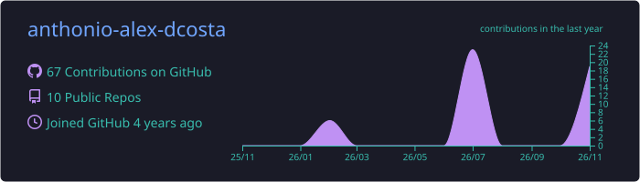
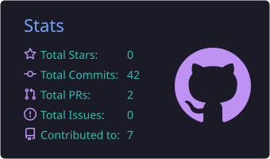
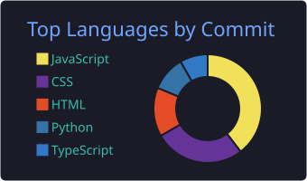
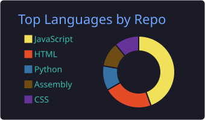
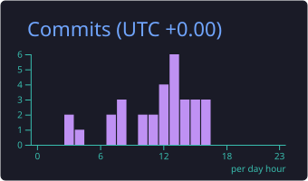

<!-- ═══════════════════════════ HEADER ═══════════════════════════ -->
<p align="center">
  
</p>

<p align="center">
  <a href="https://anthonio-alex-dcosta.github.io/portfolio/">
    
  </a>
</p>

<p align="center">
  <a href="https://anthonio-alex-dcosta.github.io/portfolio/"></a>
  <a href="https://www.linkedin.com/in/anthonio-alex-d-costa-515aba373"></a>
  <a href="https://x.com/Axel22101749"></a>
  
</p>

---

## 👨‍💻 About me

```ts
const anthonio = {
  role:        "Full Stack Developer",
  education:   "BSc in Computer Science & Engineering · Brac University (CGPA 3.80)",
  experience:  "Student Tutor @ Brac University (CSE111 · CSE220 · CSE221)",
  frontend:    ["React", "Next.js", "TypeScript", "Tailwind CSS"],
  backend:     ["Node.js", "Express", "FastAPI", "Django", "Flask"],
  databases:   ["MongoDB", "MySQL"],
  web3:        ["Solidity", "Web3.js", "Truffle", "MetaMask"],
  interests:   ["Blockchain", "Cybersecurity & Forensics", "Ethical AI", "Privacy-Preserving ML"],
  currently:   "Shipping production web apps for real businesses",
  available:   true, // open for freelance 🤝
};
```

- 🌐 I build **end-to-end products**: UI, API, database and deployment
- 🔐 I care about **security first**: auth, data integrity and systems that hold up under attack
- ⛓️ I build **decentralized apps** with smart contracts and on-chain identity
- 🧑‍🏫 I spent two years as a student tutor, teaching programming, data structures and algorithms
- ⚡ Fun fact: I've shipped everything from **x86 Assembly** tools to **Next.js** web apps

---

## 🛠️ Tech stack

<p align="center"><b>Languages</b></p>
<p align="center">
  <a href="https://skillicons.dev"></a>
</p>

<p align="center"><b>Frontend</b></p>
<p align="center">
  
</p>

<p align="center"><b>Backend &amp; databases</b></p>
<p align="center">
  
</p>

<p align="center"><b>DevOps, Web3 &amp; tools</b></p>
<p align="center">
  
</p>

---

## 🚀 Featured projects

<table>
  <tr>
    <td width="50%" valign="top">
      <h3>📚 <a href="https://github.com/anthonio-alex-dcosta/StoryGram">StoryGram</a></h3>
      <p>A social platform for book lovers, with personal libraries, lending, reviews, auctions and <b>AI story generation</b>.</p>
      
      
      
    </td>
    <td width="50%" valign="top">
      <h3>🔎 <a href="https://github.com/anthonio-alex-dcosta/Missing-persons-dapp">Missing Persons DApp</a></h3>
      <p>A transparent Ethereum DApp with role-based access for admins, reporters and investigators, and on-chain case tracking.</p>
      
      
      
    </td>
  </tr>
  <tr>
    <td width="50%" valign="top">
      <h3>🍔 <a href="https://github.com/anthonio-alex-dcosta/Express-react-app">Foodzilla (MERN)</a></h3>
      <p>A scalable restaurant app with a React frontend, an Express REST API and MongoDB, with a clean split between frontend and backend.</p>
      
      
      
    </td>
    <td width="50%" valign="top">
      <h3>🎬 <a href="https://github.com/anthonio-alex-dcosta/Movie-Ticket-Service">Cinema Ticket Service</a></h3>
      <p>A movie booking platform with auth, ticketing, payments, user profiles and fan clubs.</p>
      
      
      
    </td>
  </tr>
  <tr>
    <td width="50%" valign="top">
      <h3>🆔 Metaverse ID</h3>
      <p>A secure, decentralized <b>self-sovereign identity (SSI)</b> authenticator for the metaverse, built on blockchain.</p>
      
      
    </td>
    <td width="50%" valign="top">
      <h3>🧮 <a href="https://github.com/anthonio-alex-dcosta/Unit_ConV">DOS Unit Converter</a></h3>
      <p>A low-level x86 Assembly tool that converts measurements through a text menu and direct system interrupts.</p>
      
    </td>
  </tr>
</table>

<p align="center">
  <a href="https://github.com/anthonio-alex-dcosta?tab=repositories"></a>
</p>

---

## 📊 GitHub stats

<p align="center">
  
</p>

<p align="center">
  
  
</p>

<p align="center">
  
  
</p>

<p align="center">
  
</p>

<p align="center">
  <picture>
    <source media="(prefers-color-scheme: dark)" srcset="https://raw.githubusercontent.com/anthonio-alex-dcosta/anthonio-alex-dcosta/output/github-snake-dark.svg" />
    <source media="(prefers-color-scheme: light)" srcset="https://raw.githubusercontent.com/anthonio-alex-dcosta/anthonio-alex-dcosta/output/github-snake.svg" />
    
  </picture>
</p>

---

## 🤝 Let's build something together

I'm **open to freelance work and collaborations**: full stack web apps, dashboards, APIs and blockchain projects.
If you have an idea, a product to ship or just want to talk tech, reach out! 👇

<p align="center">
  <a href="https://anthonio-alex-dcosta.github.io/portfolio/#contact"></a>
  <a href="https://www.linkedin.com/in/anthonio-alex-d-costa-515aba373"></a>
</p>

<p align="center">
  
</p>
